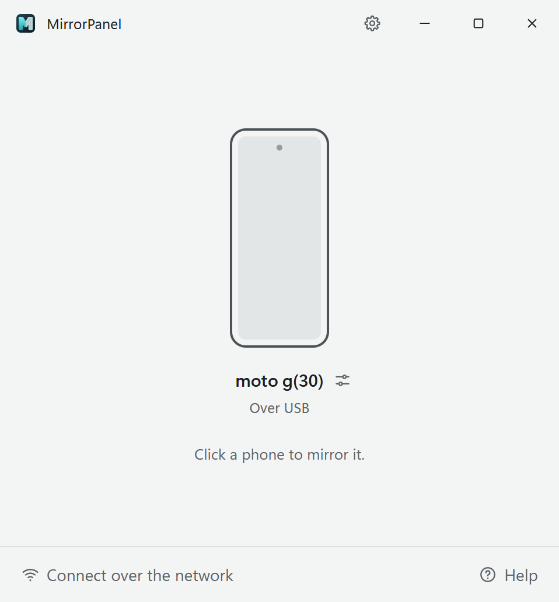

# MirrorPanel

<div align="center">

[](https://github.com/syhhw/MirrorPanel/releases/download/v2.0.0-preview.5/MirrorPanel-Setup-2.0.0-preview.5.exe)
[](https://github.com/syhhw/MirrorPanel/releases)
[](https://github.com/syhhw/MirrorPanel/actions/workflows/native-tests.yml)

<picture>
  <source media="(prefers-color-scheme: dark)" srcset="docs/panel-dark.png">
  
</picture>

</div>

Mirror and control Android phones from Windows. Each phone opens in its own
window, where you use it with the mouse and keyboard, hear its audio, take
screenshots, record video and drop files onto it.

MirrorPanel has its own engine: Electron and WebCodecs on the PC, a small Java
server and the MirrorPanel Companion app on the phone. The official ADB is
included, so there is nothing else to install.

> This is a preview (2.0.0-preview.5). [MirrorPanel 1.3.1](https://github.com/syhhw/MirrorPanel/releases/tag/v1.3.1)
> is still the latest stable release.

## Install

1. Download `MirrorPanel-Setup-2.0.0-preview.5.exe` from
   [Releases](https://github.com/syhhw/MirrorPanel/releases) and run it. It installs
   for the current user and does not need administrator rights.
2. The installer is not code-signed yet. If Windows SmartScreen stops it, choose
   **More info**, then **Run anyway**.

If MirrorPanel 1.x is installed, the setup replaces it in the same folder and keeps
its nicknames, language and window options. To go back, uninstall it and install 1.3.1.

## Use

1. On the phone, turn on USB debugging (Settings, Developer options).
2. Connect the phone with a USB cable and allow this computer when Android asks.
3. Click the phone in the panel. The first time, MirrorPanel installs its Companion
   app on the phone, which shows a notification while the phone is being mirrored.
4. To hear the phone, click the headphones button in the mirror window and tap
   **Start** on the phone. Android calls this "recording or casting"; MirrorPanel
   uses only the audio.

To connect without a cable, use **Connect over the network** in the panel.

| Mouse and keyboard | Action |
| --- | --- |
| Alt + click | Anchors one finger; drag the second point for multitouch |
| Right button / Esc | Back (Esc also releases held contacts) |
| Middle button / Home | Home |
| End | Recent apps |
| Ctrl + V | Pastes the computer's text on the phone |
| F11 | Fullscreen |

## Features

- H.264 video decoded on the PC, one window per phone, several phones at once
- Media audio in stereo, with volume control on the computer
- Typing in any language, including accents, composition and emoji
- Multi-touch with Alt + click, scroll and Android navigation buttons
- PNG screenshots with a preview, MP4 recording with sound, saved to
  `Videos\MirrorPanel Media`
- Drop an APK on the window to install it, or other files to send them to the
  phone's Download folder
- USB, Wi-Fi by IP address and pairing by code
- Quality presets, nicknames, always on top, and keeping the phone screen on over USB
- English and Portuguese interface, light and dark themes; the Companion follows
  the phone's language

## Requirements and limits

- Windows 10 or 11, 64-bit; Android 10 or later.
- Audio depends on each app's policy: calls, protected content and the microphone
  are not captured.
- Rotating the phone or turning audio on or off ends the current recording.
- Not available yet: H.265, two-way clipboard, QR pairing, tray mode and automatic
  updates.

## Build from source

The app is in [native](native/README.md). It needs Node 22.12 or later, Python 3, JDK 17, the
Android SDK (platform 35, build-tools 36.0.0) and, for the installer, Inno Setup 6.

```powershell
cd native
npm ci
node node_modules/electron/install.js
npm run android
npm run typecheck
npm run lint
npm test
npm run test:android
npm start
npm run installer
```

[Build, tests and signing](native/README.md) · [Architecture](docs/ENGINE.md) ·
[MPV1 protocol](native/docs/PROTOCOL.md)

The 1.x app, a Python front end for [scrcpy](https://github.com/Genymobile/scrcpy),
lives on the [`old`](https://github.com/syhhw/MirrorPanel/tree/old) branch.

## License

MirrorPanel is licensed under the [Apache License 2.0](LICENSE). Electron and
mp4-muxer are MIT; ADB (Apache 2.0) and Chromium notices ship with the app.
